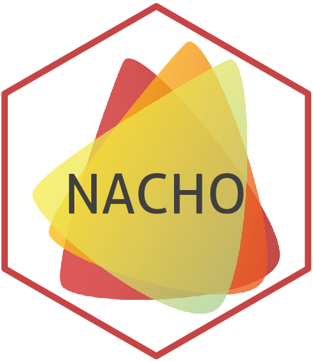
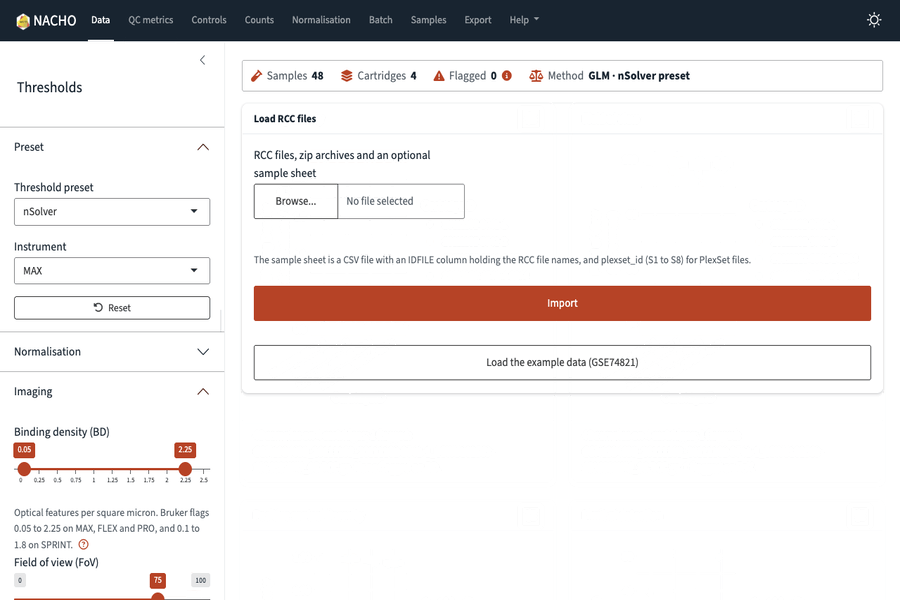

```{r}
#| echo: false
knitr::opts_chunk$set(
  collapse = TRUE,
  comment = "#>",
  fig.path = "man/figures/README-",
  out.width = "100%"
)
```

# NAnoString quality Control dasHbOard 

[](https://lifecycle.r-lib.org/articles/stages.html)
[](https://github.com/mcanouil/NACHO)
[](https://app.codecov.io/gh/mcanouil/NACHO?branch=main)
[](https://github.com/mcanouil/NACHO/actions/workflows/R-CMD-check.yml)
[](https://cran.r-project.org/package=NACHO)
[](https://cran.r-project.org/web/checks/check_results_NACHO.html)
[](https://cran.r-project.org/package=NACHO)

## Installation

```{r}
#| eval: false
# Install NACHO from CRAN:
install.packages("NACHO")

# Or the development version from GitHub:
# install.packages("pak")
pak::pak("mcanouil/NACHO")
```

## Quick start

The package ships six samples of the public study GSE178516, so this runs offline.
`load_rcc()` reads the RCC files, computes the quality-control metrics and normalises the counts.

```{r}
#| label: quick-start
library(NACHO)

data_directory <- system.file("extdata", "GSE178516", package = "NACHO")
nacho <- load_rcc(
  data_directory = data_directory,
  ssheet_csv = file.path(data_directory, "samplesheet.csv"),
  id_colname = "IDFILE",
  instrument = "max",
  n_comp = 5
)
nacho_qc(nacho)[, c("IDFILE", "status", "n_flags", "reason")]
```

`autoplot()` draws any quality-control figure, `render()` writes a report with Quarto, and `visualise()` opens the app.

```{r}
#| label: quick-start-plot
#| fig-alt: "Box plot of the binding density of each cartridge, with the limits of the quality control drawn as dashed lines."
autoplot(nacho, type = "BD")
```

```{r}
#| eval: false
render(nacho, output_dir = tempdir())
visualise(nacho)
```

## Overview

NACHO works with NanoString nCounter data.
It reads the RCC files, flags the samples that fail quality control and normalises the counts.

- `load_rcc()` reads the RCC files and a sample sheet, computes the quality-control metrics and normalises the counts.
- `visualise()` opens a Shiny app to look at every metric and change the limits.
- `autoplot()` draws any quality-control figure as a `ggplot2` plot.
- `render()` writes a quality-control report with Quarto, as an HTML or a PDF file.
- `normalise()` runs the normalisation again with new settings.

The [package website](https://m.canouil.dev/NACHO/) shows the app, the report and a full analysis.

### Shiny application

Open the app on a `nacho` object with `visualise()`.

```{r}
#| eval: false
visualise(GSE74821)
```

```{r}
#| echo: false
#| fig-alt: "Short recording of the NACHO app on the example data. The summary strip changes when the field of view threshold moves to 95 and one sample is flagged. A selected sample is outlined in the QC metrics plots. The recording then shows the Samples, Normalisation and Batch pages, the Help menu, and the Export page with a report ready to download."

```

The articles "Explore quality control in the app" and "Analyse a GEO study" on the [package website](https://m.canouil.dev/NACHO/) show each page of the app and a full analysis of GSE178516.
The article "Moving from NACHO 2" on the same website maps the NACHO 2 code to NACHO 3.

## Citing NACHO

```{r}
#| echo: false
#| results: asis
print(citation("NACHO"), "html")
```

```{r}
#| echo: false
#| comment: ""
print(citation("NACHO"), "bibtex")
```

---

## Getting help

If you encounter a clear bug, please file a minimal reproducible example on [GitHub](https://github.com/mcanouil/NACHO/issues).  
For questions and other discussion, please contact the package maintainer.

## Code of Conduct

Please note that this project is released with a [Contributor Code of Conduct](https://github.com/mcanouil/NACHO/blob/main/.github/CODE_OF_CONDUCT.md).  
By contributing to this project, you agree to abide by its terms.
