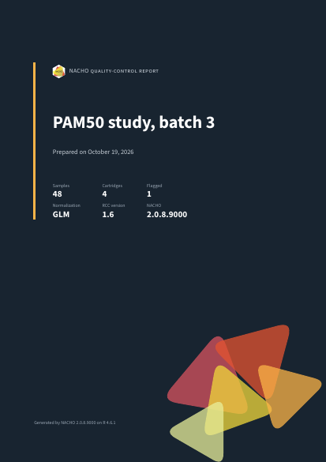

# NACHO

Step 1

## Load

Read the RCC files and a sample sheet. One call computes the
quality-control metrics and normalises the counts.

[`load_rcc()`](https://m.canouil.dev/NACHO/dev/reference/load_rcc.md)

Step 2

## Check

Look at each metric in the app, or plot one metric in your own script.

[`visualise()`](https://m.canouil.dev/NACHO/dev/reference/visualise.md)
[`autoplot()`](https://m.canouil.dev/NACHO/dev/reference/autoplot.md)

Step 3

## Share

Write an HTML or PDF report that records the decisions you made.

[`render()`](https://m.canouil.dev/NACHO/dev/reference/render.md)


The quality-control metrics page of the NACHO app, with a box plot for
each metric and the limits drawn as dashed lines.

Shiny app

## See every sample, change every limit

- The summary strip counts the flagged samples while you move a limit.
- Select a sample once, and every plot outlines it.
- Separate pages show the control probes, the normalisation and the
  batch effects.
- The Export page writes the report from the app.

``` r

visualise(nacho)
```

[Explore quality control in the
app](https://m.canouil.dev/NACHO/dev/articles/nacho-app.md)


The top of the HTML report, with the study header and the decision
summary for one flagged sample.



The cover page of the PDF report.


A page of the PDF report, with the running header, the decision summary
and the page footer.

Quarto report

## A quality-control record you can hand over

- The same `nacho` object gives an HTML report or a PDF report.
- The decision summary comes first: which samples fail, and why.
- Figures have numbers and captions, and tables are accessible.
- A methods section records the settings and the software versions.

``` r

render(nacho, format = "typst")
```

[Write a quality-control
report](https://m.canouil.dev/NACHO/dev/articles/nacho-report.md)


Box plot of the binding density of each cartridge, with the limits of
the quality control drawn as dashed lines.

Analysis

## Part of your R workflow

- [`autoplot()`](https://m.canouil.dev/NACHO/dev/reference/autoplot.md)
  draws each quality-control figure as a `ggplot2` plot.
- [`normalise()`](https://m.canouil.dev/NACHO/dev/reference/normalise.md)
  and
  [`exclude_outliers()`](https://m.canouil.dev/NACHO/dev/reference/exclude_outliers.md)
  run again with new settings.
- [`as_summarized_experiment()`](https://m.canouil.dev/NACHO/dev/reference/as_summarized_experiment.md)
  gives the counts to Bioconductor.

[Analyse a GEO
study](https://m.canouil.dev/NACHO/dev/articles/nacho-analysis.md)
[Moving from NACHO
2](https://m.canouil.dev/NACHO/dev/articles/moving-from-nacho-2.md)

## Installation

Install the release from CRAN:

``` r

install.packages("NACHO")
```

If you want the development version without an extra package, install it
from R-universe:

``` r

install.packages(
  "NACHO",
  repos = c("https://mcanouil.r-universe.dev", "https://cloud.r-project.org")
)
```

If you want the latest commit, install it from GitHub with pak:

``` r

# install.packages("pak")
pak::pak("mcanouil/NACHO")
```

## Cite and get help

If you use NACHO in your work, [cite the article in
*Bioinformatics*](https://m.canouil.dev/NACHO/dev/authors.html#citation).
To report a bug, open an issue on
[GitHub](https://github.com/mcanouil/NACHO/issues) with a minimal
reproducible example. This project has a [Contributor Code of
Conduct](https://github.com/mcanouil/NACHO/blob/main/.github/CODE_OF_CONDUCT.md).
